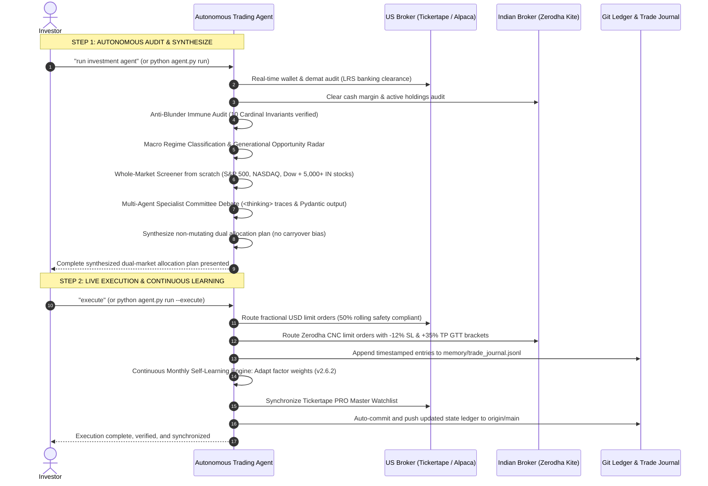
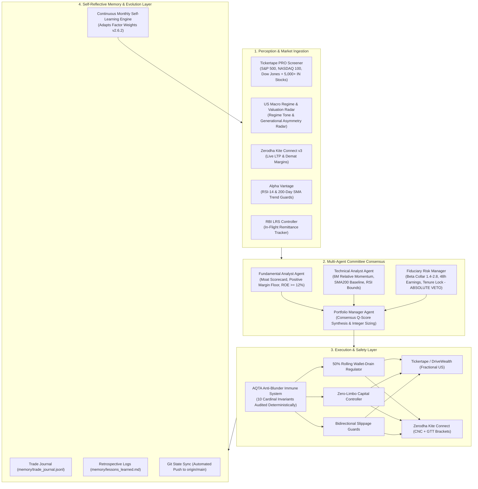

# Autonomous Quantitative Trading Agent (AQTA)

<p align="center">
  
</p>

[](https://opensource.org/licenses/MIT)
[](https://www.python.org/)
[](https://modelcontextprotocol.io/)
[](https://m8ven.ai/mcp/kevinhayesanderson/autonomous-trading-agent?s=readme)
[](https://docs.pydantic.dev/)
[](docs/security_audit_report.md)
[](docs/security_audit_report.md)
[]()
[]()

Institutional-grade, multi-agent quantitative trading system engineered for **autonomous recurring capital allocation across dual global markets**:
1. **US Equities**: Whole-market secular compounders across S&P 500, NASDAQ 100, and Dow Jones (enterprise hardware, cloud infrastructure, cybersecurity, defense AI, and semiconductor leaders) via **Tickertape / DriveWealth** (live fractional execution) and **Alpaca** (paper shadow sandbox).
2. **Indian Equities**: Secular capex, industrial manufacturing, and power infrastructure leaders via **Zerodha Kite Connect v3** (live delivery cash CNC & GTT brackets) and **Tickertape PRO India**.

AQTA features the **Anti-Blunder Immune System** (10 Cardinal Invariants audited deterministically), **Continuous Monthly Self-Learning Engine** (adaptive factor calibration), test-time compute with extended reasoning traces, strict Pydantic v2 schemas, native Model Context Protocol (MCP 2.x), and an immutable Git-synced memory ledger.

---

## Autonomous Operation: The 2-Interaction Contract

An autonomous agent does **not** burden the investor with dozens of granular CLI flags. All scanning, risk auditing, factor weighting, and state syncing happen **internally**. The investor interacts via a strict 2-step decision loop:



| Step | User Prompt / CLI Command | What the Autonomous Agent Executes Internally |
| :---: | :--- | :--- |
| **1. Preview** | `python agent.py run`<br>*(or "run investment agent")* | **Zero-Action Audit**: Checks dual wallets, verifies the 10 Anti-Blunder Invariants, scans macro regimes, algorithmically screens 1,000+ US and 5,000+ Indian stocks, deliberates with test-time reasoning traces, and formulates an exact, non-mutating dual allocation plan. |
| **2. Execute** | `python agent.py run --execute`<br>*(or "execute")* | **Zero-Limbo Execution**: Routes live orders, sets -12% Stop-Loss and +35% Take-Profit GTT brackets, commits to `trade_journal.jsonl`, triggers monthly factor learning, updates watchlists, and auto-syncs state to remote Git. |

---

## System Architecture



---

## 🛡️ The Fiduciary Anti-Ruin Mandate & 10 Cardinal Invariants

Every dollar and rupee allocated represents hard-earned salary and a long-term gateway out of poverty. The system concentrates capital into dominant high-beta monopolies without reckless speculation:

| Invariant ID | Rule & Invariant Collar | Engineering Rationale & Protection |
| :--- | :---: | :--- |
| `BLUNDER_01` | **Positive Net Margin Floor** ($\text{Net Margin} > 0\%$) | **Strict Capital Preservation**: Any cash-burning business is instantly VETOED. |
| `BLUNDER_02` | **Trend Baseline Guard** ($\text{Price} \ge \text{SMA}_{200}$) | **Anti-Falling Knife**: Disqualifies assets in structural downtrends. |
| `BLUNDER_03` | **Institutional Capital Floor** ($\ge \$20\text{B US} / \ge ₹2,000\text{Cr IN}$) | **Titan Sponsorship**: Zero penny stocks, illiquid micro-caps, or post-IPO hype traps. |
| `BLUNDER_04` | **Bounded High-Beta Collar** ($1.40 \le \beta \le 2.80$) | **Controlled Aggression**: Captures secular bull runs, but caps speculative ruin. |
| `BLUNDER_05` | **Fiduciary Sequencing** | **Capital Recycling**: Sells and stop-losses settle before new buy allocations are sized. |
| `BLUNDER_06` | **50% Wallet-Drain Regulator** ($\text{Spend} \le 0.49 \times \text{Cash}$) | **Broker Safety**: Prevents DriveWealth 60-min lockout (`WALLET_DRAIN_LIMIT_EXCEEDED`). |
| `BLUNDER_07` | **60-Day Anti-Churn Tenure Lock** ($\text{Tenure} \ge 60\text{ Days}$) | **Tax & Fee Shield**: Protects holdings $< 60$ days from churn (saves 31.2% STCG & 1.17% fees). |
| `BLUNDER_08` | **48-Hour Earnings Blackout** ($\pm 48\text{h}$ window) | **Event-Risk Roulette Guard**: -25 point penalty prevents binary earnings gap-down ambushes. |
| `BLUNDER_09` | **Zero-Limbo Capital Controller** | **Capital Efficiency**: Residual funds from failed legs roll into the primary conviction leader. |
| `BLUNDER_10` | **Cross-Platform Resilience** | **ASCII & UTF-8 Safety**: Hardened stream encodings eliminate charmap crashes on Windows/Linux. |

*Concentrated Conviction: Up to 5 total active portfolio holdings per market to ensure deep conviction and zero dilution.*

---

## CLI & Operations Reference

AQTA is designed to run autonomously with minimal commands:

### Primary Autonomous Interface
```bash
python agent.py auth                # 1-step dual-broker login (Tickertape PRO + Zerodha Kite)
python agent.py run                 # Step 1: Autonomous dual-market preview from scratch
python agent.py run --execute       # Step 2: Live execution, self-learning, and Git state sync
python agent.py status              # Real-time portfolio balances, demat holdings, and P&L
```

### Verification & Administration (Optional)
```bash
python agent.py test                # Run 7-phase mathematical system verification
python agent.py eval                # Run 7-phase SOTA agentic fiduciary evaluation benchmark
python agent.py immune              # Audit portfolio against the 10 Cardinal Anti-Blunder Invariants
python agent.py serve-mcp           # Launch Model Context Protocol (MCP 2.x) server
```

> **Why so few commands?** In an autonomous quantitative system, screeners, risk vetoes, factor calibration, and Git synchronization are **handled internally** during the master cycle (`python agent.py run`). Manual subcommand proliferation is intentionally avoided.

---

## Model Context Protocol (MCP 2.x) Integration

AQTA includes an enterprise Model Context Protocol server ([`server/mcp_server.py`](server/mcp_server.py)) built on the official **MCP 2.x SDK**, enabling native integration with Antigravity, Claude Desktop, Cursor, and Windsurf:

### Tools (12 Certified Tools)
* `trading_get_portfolio_status`: Real-time cash, active holdings, P&L, and LRS transit metrics.
* `trading_run_screener`: Whole-market quantitative screener with anti-ruin vetoes.
* `trading_deliberate_ticker`: SOTA multi-agent deliberation with test-time reasoning traces and Pydantic output.
* `trading_preview_rebalance`: Non-mutating preview of portfolio rebalancing recommendations.
* `trading_execute_rebalance`: Live execution with quote-lock resilience and Zero-Limbo safety.
* `trading_audit_immune_system`: Deterministic audit of the 10 Cardinal Anti-Blunder Invariants.
* `trading_run_self_learning_cycle`: Continuous monthly factor adaptation and retrospective logging.
* `trading_get_market_regime`: US macro regime analysis & Generational Asymmetry Sale Radar.
* `trading_drain_wallet`: Micro-drain of settled funds into target leader respecting 50% limits.
* `trading_get_memory_state`: Inspects 4-tier memory, factor weights, and trade history.
* `trading_run_system_test`: Runs 7-phase mathematical verification suite.
* `trading_run_agent_evals`: Runs SOTA agentic evaluation and fiduciary benchmark suite.

### Resources & Prompts
* `resource://portfolio/status`: Real-time JSON snapshot of portfolio holdings and cash.
* `resource://portfolio/immune_system`: 10 Cardinal Anti-Blunder Invariant status.
* `resource://portfolio/learnings`: Monthly self-learning retrospective & factor adaptations.
* `resource://market/regime`: Macro market regime & valuation sale radar.
* `prompt://committee_deliberation(ticker)`: Interactive prompt for conducting a full committee debate.

---

## Verification & Benchmark Scorecard

| Suite | Command | Total Tests | Result | Status |
| :--- | :--- | :---: | :---: | :---: |
| **All Unit & MCP Tests** | `python -m unittest discover tests` | **25 / 25** | **0 Failures, 0 Warnings** | **PASS** (0.012s) |
| **Mathematical Self-Test** | `python agent.py test` | **7 / 7** | **100% Invariant Conformance** | **PASS** |
| **SOTA Agentic Evals** | `python agent.py eval` | **7 / 7** | **100% Fiduciary Conformance** | **PASS** |
| **Anti-Blunder Immune Audit** | `python agent.py immune` | **10 / 10** | **100% Systemic Protection** | **PASS** |
| **Security SAST (Bandit)** | `bandit -r trading_agent/ agent.py server/` | **5,000+ LOC** | **0 High/Medium Issues** | **PASS** |
| **Dependency SCA (pip-audit)** | `pip-audit` | **Active Venv** | **0 Known CVEs** | **PASS** |

---

## Getting Started

### 1. Installation
```bash
git clone https://github.com/kevinhayesanderson/autonomous-trading-agent.git
cd autonomous-trading-agent
pip install -r requirements.txt
python scripts/setup_env.py
```

### 2. Environment Configuration
Copy [`.env.example`](.env.example) to `.env` and provide your credentials:
```ini
# Zerodha Kite Connect v3 (Indian Equities)
KITE_API_KEY=your_kite_api_key
KITE_API_SECRET=your_kite_api_secret
KITE_REDIRECT_URL=http://127.0.0.1:8000/

# Tickertape PRO (US Equities & Indian Screener)
TICKERTAPE_TOKEN=your_bearer_token

# Alpaca Paper Trading (Shadow Sandbox)
ALPACA_KEY=your_alpaca_key
ALPACA_SECRET=your_alpaca_secret

# Alpha Vantage (Technical Indicators)
AV_API_KEY=your_alpha_vantage_key
```

### 3. Verification & Execution
```bash
python agent.py test                # Verify all mathematical invariants
python agent.py run                 # Step 1: Preview live dual-market plan
python agent.py run --execute       # Step 2: Commit confirmed live orders
```

---

## License

Distributed under the **MIT License**. See [`LICENSE`](LICENSE) for details.
